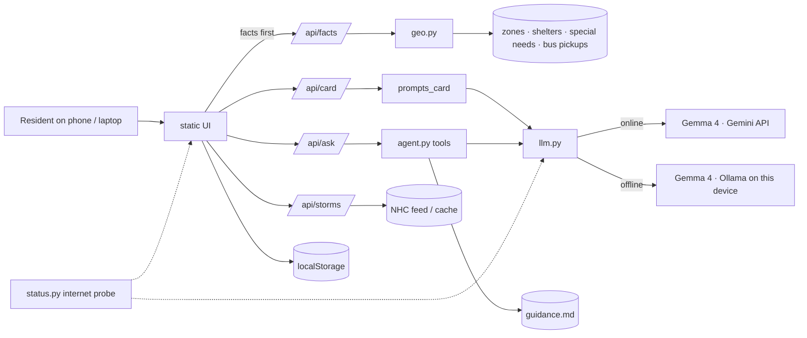
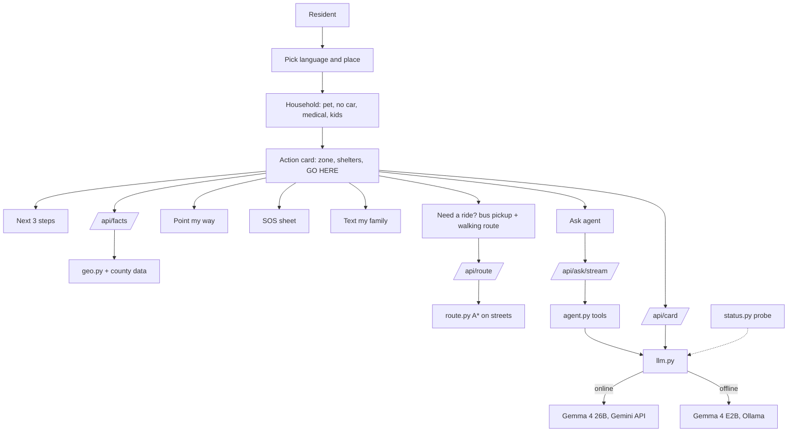

# StormCard

**StormCard turns a Miami-Dade address into a hurricane action card in Kreyòl, Español and English, and keeps answering questions when the internet is down (Gemma 4 runs locally).**

Built for [Hack for Humanity: Miami](https://github.com/AI-Collective-Hackathons/hack-for-humanity-miami), October 10, 2026, The LAB Miami.

## Track and prizes

- **Track:** 01 Four Forces, One City (Air + Water)
- **Prizes targeted:** MLH Best Open-Source AI Project, MLH Best Use of Gemma 4

## The problem

Madame Joseph is a **composite persona**, not a real person: 74, Little Haiti, speaks Haitian Creole and little English, has a small dog, no car.

- Hurricane guidance is mostly English, and she cannot tell which storm surge zone she lives in.
- Most shelters do not take pets, and she does not know where to go or how to get there without a car.
- Cell towers and internet fail first, exactly when cloud-only apps stop answering.

## What it does

- **Surge zone plate:** her Miami-Dade storm surge planning zone (A to E), in her language.
- **Shelter candidates that fit her household:** pets, and special-needs shelters for medical needs.
- **"Need a ride?":** the nearest county evacuation bus pickup. Buses run only when an evacuation is ordered; call 311.
- **Map:** Google Maps online; offline, an SVG map drawn from county main roads and surge zones.
- **Ask agent:** follow-up questions with live-streamed tool steps (`find_shelters`, `get_zone`, `packing_list`, `lookup_guidance`, `evacuation_help`, `draft_message`).
- **"Text my family":** a code-built SMS draft that she sends herself.
- **NHC storm card:** current storms from the National Hurricane Center.
- **Your next 3 steps** and **"What should I do right now?"**: code chains `get_zone` -> `evacuation_help`/`find_shelters` -> `packing_list` (streamed); the model writes 3 numbered steps, with a code-built fallback.
- **Need a ride?** nearest county evacuation bus pickup, a walking route on county streets (`route.py`, `/api/route`) and a turn list.
- **Point my way:** camera + compass that follows the route; needs HTTPS (`python app.py --https` or a tunnel).
- **SOS sheet:** 911 / text my location / 311. It never sends anything on its own.
- **Online/Offline light:** plain green/red light, no model names in the resident UI; automatic, no switch.
- **Recommended shelter** shown as "GO HERE"; trilingual (Kreyòl, Español, English); PWA with a new logo.
- **Offline map:** county roads and streets (gzipped) plus surge zones; Google map when online.

## How the AI is used

| Mode | Model | Runtime |
|---|---|---|
| Online | Gemma 4 `gemma-4-26b-a4b-it` (thinking_level minimal) | Gemini API |
| Offline | Gemma 4 `gemma4:e2b-it-qat` | Ollama, on the device |

**Facts by code, words by model.** Zone, shelter names, addresses and phones come from county data and are inserted by code into fixed slots; the model writes only the short prose around them. Guardrails:

- Grounding check rejects output that names an invented place, phone number or zone.
- No claim that an evacuation has been ordered.
- When unsure, the answer is "I don't know, call 311".

Gemma is used under the [Gemma Terms of Use](https://ai.google.dev/gemma/terms).

## Data sources

| Data | Source | Notes |
|---|---|---|
| Storm surge zones | Miami-Dade `StormSurgePlanningZone` | `data/zones.geojson` |
| Shelters | FDEM Risk Shelter Inventory, Miami-Dade, as of 2021-08-31 | Planning candidates only; pet status shown only where the source says "Yes" |
| Special-needs shelters | FDEM special-needs shelter inventory | Medical-need matching |
| Evacuation bus pickups | Miami-Dade Emergency Evacuation Bus Pick-Up sites (129) | Cached for offline |
| Roads | Miami-Dade Highway + MajorRoads layers | `data/roads.geojson`, offline map |
| Streets | Miami-Dade StreetNetwork (Brickell-Wynwood-Little Haiti + Hialeah) | Walking routes |
| Storms | NHC `CurrentStorms.json` | Cached; hidden if unavailable |
| Guidance | Miami-Dade Emergency Management, ready.gov | `data/guidance.md` |

**Limitations:** the shelter list is old and no live capacity feed exists, so every shelter is a candidate to confirm with 311. Addresses are located within Miami-Dade bounds only, with no street geocoding. Walking routes cover only the two street-data areas and have no sidewalk data. Regular Metrobus service is suspended in storms and is not shown.

## Architecture



StormCard runs on one device (Flask + Ollama). Offline answers come from Gemma 4 running locally on that device (the laptop in today's demo; phones on its Wi-Fi); static assets, fonts and map data are all served locally, so it works with the internet off. Details: [docs/ARCHI.md](docs/ARCHI.md). **Future:** on-phone Gemma 4 E2B, a county "open once to save offline" notice, Gemma 4 E2B on the phone itself.

## Run it

```bash
git clone https://github.com/Piyush20001/h4h-miami.git && cd h4h-miami
python3 -m venv .venv && source .venv/bin/activate
pip install -r requirements.txt
cp .env.example .env     # set GEMINI_API_KEY (https://aistudio.google.com/apikey); MAPS_API_KEY is optional
ollama pull gemma4:e2b-it-qat
python app.py            # http://localhost:8000
```

- **Offline rehearsal:** `HUB_OFFLINE=1 python app.py` (env var name only; or turn Wi-Fi off); Ask then uses Ollama.
- **Phone camera/compass:** needs HTTPS, see [Phone (HTTPS)](#phone-https).
- Without `MAPS_API_KEY` the map falls back to the offline chart.

### Phone (HTTPS)

iPhone Safari only allows camera and compass on HTTPS. Run `python app.py --https` to serve HTTPS on port 8443 with a self-signed certificate (generated into `certs/`, gitignored). On the iPhone open `https://<laptop-ip>:8443`, tap **Show Details**, then **visit this website**. Phone and laptop must be on the same Wi-Fi. Phone steps: [docs/MOBILE.md](docs/MOBILE.md).

## User flow and data flow



## Evaluation

Online Gemma 4 26B: 35/36 cards pass (en 12/12, es 11/12, kre 12/12), 0 rule violations. Offline E2B: kre 11/12. 50 tests pass.

## Tests

```bash
.venv/bin/python -m pytest -q test_geo.py test_prompts_card.py tests/
```

Card quality evals (kre/es/en): `evals/run_evals.py`.

## Team

- **Piyush Mishra:** AI slice (LLM client, agent, Ask, storms, status, UI integration)
- **Stuti Agarwal:** card slice (geo, prompts, data, evals, mobile/iOS notes)

Split per [docs/ARCHI.md](docs/ARCHI.md) section 12.

**AI tools used:** Claude Code (Claude Opus 5.5, Sonnet 5.5 subagents, Fable as advisor), OpenAI Codex CLI (code review; image generation for the logo and icons), and Gemma 4 (the product's model).

## License and disclaimer

[MIT](LICENSE). StormCard is **not an official Miami-Dade product**. Always follow official evacuation orders and call **311** to confirm shelters, buses and zones.
