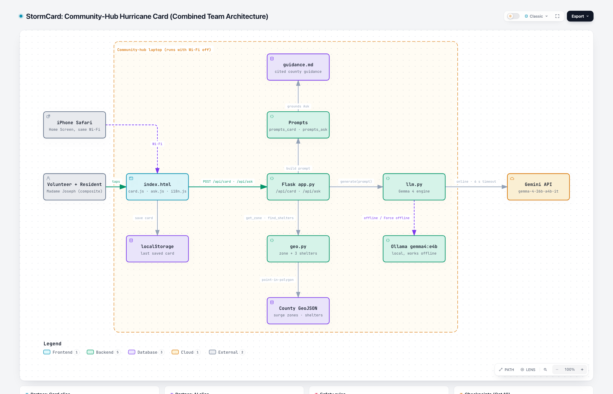
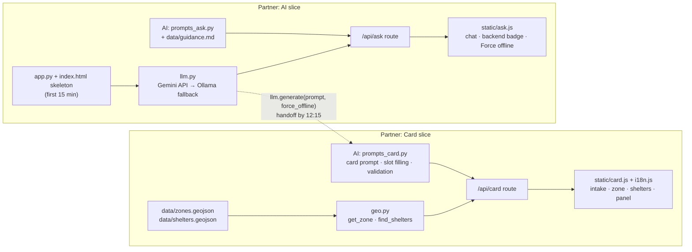
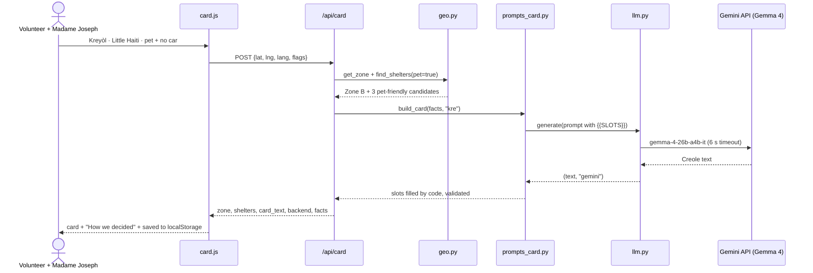
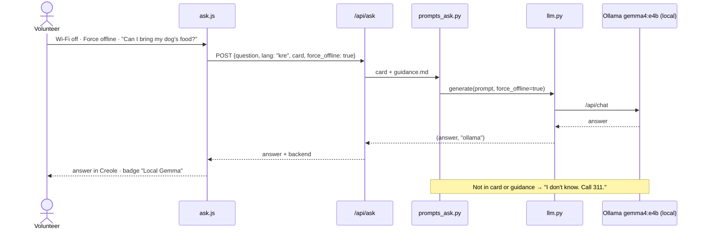

# StormCard: Combined Team Plan

Hack for Humanity: Miami · Saturday, Oct 10, 2026 · Build ends **3:30 PM**, submit by **3:45 PM** (we target **3:00 PM**).

StormCard is a community-hub laptop tool. It turns a Miami-Dade address into a one-page hurricane action card in **Kreyòl, Español or English**, and keeps answering questions **with the Wi-Fi off**. County data supplies every fact; Gemma 4 only writes the words.

Full architecture reference: [`docs/ARCHI.md`](../ARCHI.md).



Interactive version: download [`docs/architecture/stormcard-architecture.html`](../architecture/stormcard-architecture.html) and open it in a browser (pan, zoom, trace paths, dark mode, export).

---

## 1. What we're entering and how we win

| Prize | How StormCard qualifies |
| --- | --- |
| **Track 01: Four Forces, One City** (Air + Water) | Hurricane readiness, networks failing in storms, storm surge zones |
| **MLH Best Open-Source AI Project** | Gemma 4 is open-weight and core; it runs locally in Ollama for the offline moment |
| **Best Use of Gemma 4** | Gemma 4 `gemma-4-26b-a4b-it` through the Gemini API, named in the README, visible in the demo |

| Rubric (weight) | What wins it |
| --- | --- |
| Community impact (30%) | Madame Joseph (composite): 74, Little Haiti, Creole only, small dog, no car. Real county data, real languages |
| Working build (25%) | Intake → card → Ask works end to end, live, offline |
| Use of AI and data (20%) | "How we decided" panel shows the county facts and which Gemma path answered |
| Originality and craft (15%) | Offline local Gemma; facts by code, words by model |
| Demo clarity (10%) | One persona, one moment: Wi-Fi off, she still gets an answer |

---

## 2. Who builds what

Each partner builds a full feature: backend, AI and UI.



| | Card partner | AI partner |
| --- | --- | --- |
| Backend | GeoJSON download + field mapping, `geo.py`, `/api/card` | `app.py` + `index.html` skeleton, `/api/ask` |
| AI | `prompts_card.py`: card prompt, `{{SLOT}}` filling, output validation, tuning in 3 languages | `llm.py` (shared Gemma 4 engine), `prompts_ask.py`, `guidance.md`, Ollama setup + timing |
| UI | `card.js`, `i18n.js`: intake, zone badge, 3 shelters, "How we decided" panel, localStorage | `ask.js`: chat, backend badge, Force-offline switch |
| README | Data sources, How to run | Problem + persona, Models + license link, Team |

**Conflict rules:** only touch your own files. In the shared `app.py` and `index.html`, edit only inside your own route or `<section>`. Work on short branches (`card`, `ai`), merge to `main` at every checkpoint, and pull before each task.

---

## 3. The contract (agree before coding)

```text
llm.generate(prompt: str, force_offline: bool) -> tuple[str, str]   # (text, "gemini" | "ollama")

POST /api/card
  in:  {lat, lng, lang: "kre"|"es"|"en", flags: {pet, no_car, medical, kids}, force_offline}
  out: {zone: "B", shelters: [{name, address, distance_mi, pet_friendly}], card_text, backend, facts}

POST /api/ask
  in:  {question, lang, card, force_offline}
  out: {answer, backend}
```

Until the real piece lands, each side codes against a stub that returns canned JSON or text.

Preset demo addresses (verify against the GeoJSON): Little Haiti (25.8300, -80.1950) · Hialeah (25.8576, -80.2781) · Brickell (25.7617, -80.1918).

---

## 4. How a request flows

**Making a card (online):**



**Asking a question with the Wi-Fi off (the demo moment):**



---

## 5. Timeline

```mermaid
gantt
    title StormCard build (Oct 10, ET)
    dateFormat HH:mm
    axisFormat %H:%M
    section Both
    Contract + ollama pull gemma4:e4b    :b1, 11:45, 15m
    Integrate CP1                         :milestone, m1, 12:30, 0m
    Lunch (eat in shifts)                 :b2, 13:15, 20m
    Wi-Fi-off rehearsal CP3 + scope freeze:crit, b3, 14:00, 15m
    README + fresh-clone run + submit     :crit, b4, 14:30, 30m
    Rehearse demo 3x                      :b5, 15:00, 30m
    section Card partner
    GeoJSON download + field mapping      :c1, 12:00, 15m
    geo.py + /api/card (facts only)       :c2, after c1, 15m
    card.js intake + zone + shelters      :c3, 12:30, 30m
    prompts_card.py + Creole tuning (CP2) :c4, 13:00, 45m
    Panel, localStorage, i18n, pet lines  :c5, 13:45, 45m
    section AI partner
    app.py + index.html skeleton          :a1, 12:00, 15m
    llm.py Gemini + Ollama, push          :crit, a2, after a1, 15m
    prompts_ask.py + guidance.md          :a3, 12:30, 40m
    /api/ask + ask.js + Force offline     :a4, 13:10, 40m
    Ollama timing, e4b vs e2b             :a5, 13:50, 25m
```



| Checkpoint | Done when |
| --- | --- |
| **12:15** | `llm.generate` pushed; Card partner drops the stub |
| **12:30 · CP1** | Little Haiti preset shows a zone + 3 shelters in the UI |
| **13:15 · CP2** | Creole card generated online, facts in code-filled slots; pick the offline demo language after judging e4b's Creole |
| **14:00 · CP3** | Wi-Fi off + Force offline → a fresh question answered by local Gemma. **Scope freeze** |
| **15:00** | README complete, fresh clone runs, **submitted in OrganizerHQ** |

---

## 6. Rules we never break

1. Zone letters, shelter names, addresses and phone numbers come **only** from data and are filled in by code, never by the model.
2. Shelters are **candidates**: "Call 311 to confirm it's open." Unknown pet eligibility is never shown as yes.
3. No "Zone X evacuates for Category Y" claims. Evacuation orders depend on the storm's track and surge.
4. Ask answers only from the card + `guidance.md`; otherwise "I don't know. Call 311."
5. Every card ends with "Follow official orders from Miami-Dade Emergency Management."
6. No CDN scripts or web fonts: everything is served from the laptop.
7. Madame Joseph is a **composite**; say so on stage.

---

## 7. Demo (2 minutes)

| Time | Say | Show |
| --- | --- | --- |
| 0:00–0:20 | "400,000 Florida households speak Haitian Creole at home. Most hurricane warnings come in English or Spanish, and when the towers go down, apps stop working." | StormCard first screen on the iPhone (Home Screen icon) |
| 0:20–0:35 | "Meet Madame Joseph, a composite: 74, Little Haiti, Creole only, a small dog, no car." | Tap Kreyòl, Little Haiti, pet + no car |
| 0:35–1:00 | "She's in Surge Zone B. Three shelters that take pets, and her card in Creole." | Zone badge, shelters, card |
| 1:00–1:15 | "Every shelter and address comes from county data. Gemma 4 only writes the words." | Open "How we decided": facts + "Gemini API" badge |
| 1:15–1:40 | "Now the storm hits." Turn Wi-Fi off. Ask in Creole: "Can I bring my dog's food?" | Laptop: Wi-Fi icon off, answer appears, badge "Local Gemma" |
| 1:40–2:00 | "Gemma 4, open-weight, on this laptop. One of these at every church and library in Little Haiti." | `ollama ps` in a terminal, then the repo link |

---

## 8. Risks and cut rules

| Risk | Check by | Cut rule |
| --- | --- | --- |
| `gemma4:e4b` not downloaded or too slow | 12:30 / 14:00 | Pull `gemma4:e2b`; cap answers at ~150 tokens; shorter context |
| Weak Creole on the local model | 13:15 | The card is written online by the 26B; demo offline Ask in Spanish if needed and say so |
| ArcGIS down or fields unclear | 12:20 | Small hand-verified dataset for the presets, labeled "sample data" |
| Gemini API errors (26B gave a few 500s earlier) | any time | Fallback to Ollama is automatic; Force offline for the demo |
| Integration slips | 12:30 | Each side keeps its stub; merge only working slices |
| Running out of time | 14:00 | Freeze scope: no new features after CP3; cut Spanish polish, pet lines, panel styling, in that order |

**Out of scope (say so if asked):** agent loop, offline phone app, address geocoding, live storm advisories, print view, live shelter capacity, SMS/accounts, counties beyond Miami-Dade, Creole text-to-speech.

---

## 9. Submission checklist (OrganizerHQ, by 3:45 PM)

- [ ] Both checked in at the door
- [ ] Project name + short description: problem, who it helps, how it works
- [ ] Public GitHub repo with MIT license (this repo)
- [ ] Technologies + AI models: Gemma 4 `gemma-4-26b-a4b-it` (Gemini API), Gemma 4 `gemma4:e4b` (Ollama), with the Gemma license link
- [ ] Track 01 selected; MLH Open-Source AI + Best Use of Gemma 4 checked
- [ ] README: track, data sources (cited), models, how to run, team, AI tools used to build (Claude Code, Codex)
- [ ] Backup demo video recorded
