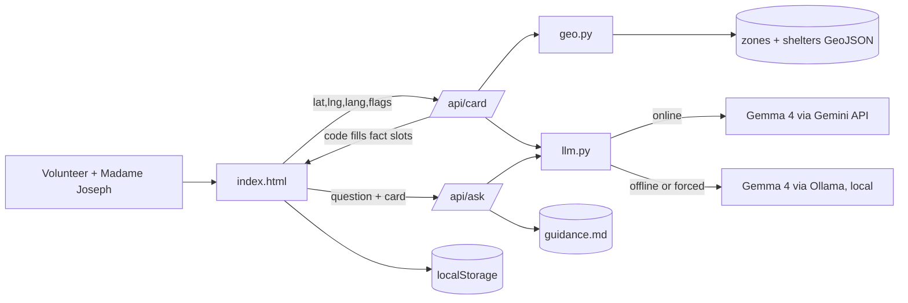

# StormCard (h4h-miami) Architecture Documentation

## 1. How to Read This Document

This is the long-term memory of the codebase for AI agents and both partners. Read it at the start of every task.

**Status markers:** **[exists]** = in the repo now. **[planned]** = in scope for today, not built yet. Update markers as features land (see `ARCHI-rules.md`).

Scope was cut on Oct 10 at 11:30 after a review by Fable and GPT-6 Astra against the Challenge Guide. The goal is to win in about 4 hours with 2 people, so anything not listed here is out of scope.

## 2. Overview

StormCard is a community-hub laptop tool. It turns a Miami-Dade address into a one-page hurricane action card in Haitian Creole (Kreyòl), Spanish or English, and keeps answering follow-up questions with the Wi-Fi off.

- **Event:** Hack for Humanity: Miami, Oct 10, 2026. Build ends 15:30, submit by 15:45 (target 15:00).
- **Track:** 01 Four Forces, One City (Air: hurricane readiness, networks failing; Water: storm surge).
- **Prizes stacked:** MLH Best Open-Source AI Project (Gemma 4 is open-weight; local Ollama is the core offline feature) and Best Use of Gemma 4 (Gemma 4 through the Gemini API).
- **Persona:** Madame Joseph, a **composite**: 74, Little Haiti, Creole only, small dog, no car. A volunteer at her church runs StormCard on the hub laptop.
- **Core principle:** facts (zone, shelter names, addresses, phone numbers) come from county data and are inserted by code. Gemma 4 only writes the words.

## 3. Technology Stack

| Layer | Technology | Status |
| --- | --- | --- |
| Server | Python 3.14 + Flask (`app.py`) | [planned] |
| Frontend | `static/index.html` + small vanilla JS files, inline CSS, **no CDN links** (they break offline) | [planned] |
| Geo | Pure-Python ray-cast point-in-polygon + haversine (`geo.py`), no shapely | [planned] |
| Online model | Gemma 4 `gemma-4-26b-a4b-it` via the Gemini API (`google-genai`) | [exists] in `gemma.py`; becomes `llm.py` |
| Offline model | Gemma 4 `gemma4:e4b` via Ollama on the same laptop (E2B if slow) | [planned]; Ollama installed, model not pulled |
| Persistence | Browser `localStorage` (last card) | [planned] |
| Dev tooling | Claude Code + TRIP workflow, Codex CLI 0.162 | [exists] |

License: MIT. Gemma 4 license: link the official Gemma terms page in the README (verify the exact license before naming it).

## 4. Project Structure

```
h4h-miami/
├── app.py                 # Flask: serves static/, POST /api/card, POST /api/ask   [planned]
├── geo.py                 # get_zone(lat,lng), find_shelters(lat,lng,pet,limit=3)   [planned]
├── llm.py                 # generate(prompt, force_offline) -> (text, backend)      [planned]
├── prompts_card.py        # card prompt + slot filling + validation (Card partner) [planned]
├── prompts_ask.py         # grounded Ask prompt (AI partner)                       [planned]
├── data/
│   ├── zones.geojson      # Miami-Dade storm surge planning zones                 [planned]
│   ├── shelters.geojson   # Miami-Dade evacuation centers                          [planned]
│   └── guidance.md        # 6–8 cited official guidance snippets                   [planned]
├── static/
│   ├── index.html         # page shell: intake / card / ask sections               [planned]
│   ├── card.js            # intake + card view + localStorage (Card partner)       [planned]
│   ├── ask.js             # Ask chat + backend badge + Force offline (AI partner)  [planned]
│   └── i18n.js            # UI strings ×3 languages (Card partner)                 [planned]
├── gemma.py               # Gemini API prototype (folds into llm.py)               [exists]
├── requirements.txt       # google-genai, python-dotenv (+ flask, requests)        [exists]
├── .env.example           # GEMINI_API_KEY, GEMMA_MODEL                            [exists]
├── LICENSE / README.md                                                              [exists]
├── docs/                  # TRIP docs; 1-plans/PLAN.md = combined team plan; architecture/ = Archify diagram
└── .claude/skills/        # TRIP skills
```

## 5. Core Architecture Principles

1. **Facts by code, words by model.** The model never outputs a zone letter, shelter name, address or phone number. Code fills those slots after generation.
2. **Protect the demo moment.** Wi-Fi off, fresh question, answer in Creole. Nothing else ships until that works.
3. **Deterministic core first.** Zone + 3 shelters work with no model at all; if the model fails, the card still shows the facts.
4. **One call, no agent loop.** One structured Gemma call per card and per question.
5. **Show the evidence.** A "How we decided" panel shows the facts JSON, shelter distances, data sources and which backend answered.
6. **Never overclaim.** Shelters are "planning candidates, call 311 to confirm open". No category-based evacuation claims. Every card ends with "Follow official orders from Miami-Dade Emergency Management."
7. **Keep it boring.** No database, auth, build step, framework, service worker or external runtime assets.

## 6. Build System & Toolchain

```bash
python3 -m venv .venv && source .venv/bin/activate
pip install -r requirements.txt
cp .env.example .env            # add GEMINI_API_KEY
ollama pull gemma4:e4b          # start first thing; large download
flask --app app run --host 0.0.0.0 --port 8000
# laptop: http://localhost:8000   iPhone (same Wi-Fi): http://<laptop-ip>:8000, then Share → Add to Home Screen
```

No build step. Offline test: turn laptop Wi-Fi off, reload the page, ask a new question.

## 7. Configuration

| Variable | Purpose | Default |
| --- | --- | --- |
| `GEMINI_API_KEY` | Gemini API key | — |
| `GEMMA_MODEL` | Gemini API model | `gemma-4-26b-a4b-it` |
| `OLLAMA_URL` | Local Ollama | `http://localhost:11434` |
| `OLLAMA_MODEL` | Offline model | `gemma4:e4b` |
| `GEMINI_TIMEOUT` | Seconds before falling back to Ollama | `6` |

The UI also has a **Force offline** toggle that sends `force_offline: true`, so the demo never depends on timeout behavior.

## 8. UI (single page) [planned]

Two views on one page:

1. **Intake:** language buttons (Kreyòl / Español / English), location (preset demo addresses with saved coordinates: Little Haiti, Hialeah, Brickell; "Use my location" if time allows), toggles (pet, no car, medical, kids: medical/kids only feed the prompt).
2. **Card:** zone badge ("Surge Zone B", plus one line that this is not the flood-insurance zone), 3 shelter candidates with distance, the Gemma card (What this means / Where to go / What to bring / What to do now), the "How we decided" panel, and an **Ask** chat underneath with a backend badge (Gemini API / Local Ollama).

Shown on the iPhone via Safari + Add to Home Screen (same Wi-Fi as the laptop) for the online part; the Wi-Fi-off moment runs in the laptop browser, because a phone in airplane mode cannot reach the laptop's Ollama. Stretch after CP3 only: a thin native wrapper app installed over USB-C with Xcode. High contrast, large type. About 15 UI strings × 3 languages, kept in `static/i18n.js`.

## 9. Server API [planned]

| Route | Request | Response |
| --- | --- | --- |
| `POST /api/card` | `{lat, lng, lang, flags:{pet,no_car,medical,kids}, force_offline}` | `{zone, shelters[3], card_text, backend, facts}` |
| `POST /api/ask` | `{question, lang, card, force_offline}` | `{answer, backend}` |
| `GET /` | — | `static/index.html` |

Agree this contract first: it's the handoff between partners.

## 10. Data Layer [planned]

| File | Source | Notes |
| --- | --- | --- |
| `zones.geojson` | [Miami-Dade ArcGIS Current_Hurricane_Evac layer 0](https://services1.arcgis.com/B4MnusZHL3vmqU3t/ArcGIS/rest/services/Current_Hurricane_Evac/FeatureServer/0) `query?where=1%3D1&outFields=*&outSR=4326&f=geojson` | Confirm the `CATEGORY` → zone A–E mapping by inspection |
| `shelters.geojson` | [Miami-Dade 311 MapServer layer 78](https://giswspro.miamidade.gov/arcgis/rest/services/311/311CRM/MapServer/78), same query | Confirm the pet-friendly field; never label unknown pet eligibility as yes |
| `guidance.md` | Miami-Dade Emergency Management pages | 6–8 short cited snippets: packing, pets, transport, special needs, "call 311" |

Fallback if ArcGIS is down or fields are unclear by 11:15 / minute 30: a small hand-verified dataset for the presets, labeled "sample data" in the UI and README. All sources are cited in the README.

## 11. Gemma 4 Integration [planned, prototype exists]

`llm.generate(prompt, force_offline)`:

1. Unless `force_offline`: call Gemini API `gemma-4-26b-a4b-it` with `GEMINI_TIMEOUT`.
2. On error/timeout or when forced: POST to Ollama `/api/chat` with `gemma4:e4b` (`num_predict` ≈ 200, short context).
3. Return `(text, backend)`; the backend shows in the UI.

**Card prompt:** input is the facts JSON with placeholders like `{{SHELTER_1}}`; output is short sentences, 6th-grade level or lower, in the chosen language. Code replaces the placeholders and validates that no stray addresses or zone letters appear.

**Ask prompt:** answer only from the card + `guidance.md`; otherwise "I don't know. Call 311." in the chosen language.

## 12. Offline Behavior

- Everything (HTML, data, guidance) is served from the laptop; no CDN, no external fonts.
- The last card is in `localStorage`, so it survives reload.
- With Wi-Fi off, `/api/ask` answers through Ollama. The claim is a **community-hub laptop**, not an offline phone app.

## 13. Team Workflow (Pair Programming)

Split by **feature slice**, each partner doing backend + frontend for their slice:

- **Partner "Card" (data → AI card → UI):** `data/zones.geojson` + `data/shelters.geojson` (download, field mapping), `geo.py`, the `/api/card` route, **AI: `prompts_card.py`** (card prompt, fact-slot filling, output validation, tuning in kre/es/en; calls `llm.generate`), `static/card.js` (intake: language, presets, toggles; zone badge, shelter list, "How we decided" panel, localStorage), `static/i18n.js` (UI strings ×3).
- **Partner "AI" (Gemma engine → Ask → UI):** `llm.py` (shared Gemma 4 engine: Gemini API + Ollama fallback + force offline, returns `(text, backend)`), **AI: `prompts_ask.py`** (grounded Ask prompt, "I don't know. Call 311."), `data/guidance.md`, the `/api/ask` route, Ollama setup and offline timing, `static/ask.js` (Ask chat, backend badge, Force-offline switch).
- **Shared, set up once at the start by AI partner:** `app.py` skeleton with both route stubs returning mock JSON, and `static/index.html` with empty `<section id="intake">`, `<section id="card">`, `<section id="ask">` that load the three JS files. After that, each partner only edits their own files; touch `app.py`/`index.html` only inside your own route/section.
- **Handoff:** one shared function, `llm.generate(prompt, force_offline) -> (text, backend)`, owned by AI partner. Until it lands (target 12:15), Card partner uses a stub returning canned text. Agree the signature first.
- README: Card partner writes Data sources + How to run; AI partner writes Models + Problem/persona.
- Short-lived branches off `main`, merge at every checkpoint, pull before each task.

| Time | Checkpoint |
| --- | --- |
| now | Start `ollama pull gemma4:e4b`; agree the API contract |
| 12:30 | CP1: `/api/card` returns zone + 3 shelters for Little Haiti; UI wired (mock until then) |
| 13:15 | CP2: Creole card online via Gemini API; pick offline demo language after judging e4b Creole |
| 14:00 | CP3: Wi-Fi-off rehearsal passes (fresh question answered locally). Scope freeze |
| 14:30 | Pet lines, packing list, polish; record backup video |
| 15:00 | README done, fresh-clone run, **submit** |
| 15:00–15:30 | Rehearse the 2-minute demo 3× |

## 14. Data Flow



## 15. Error Handling

- Gemini error/timeout → Ollama. Ollama error → show deterministic facts only, plus "call 311".
- Model output with stray facts → drop the prose and show the facts-only card.
- No guidance match → "I don't know. Call 311."

## 16. Testing Strategy

Manual checks are the gate today (see `docs/4-unit-tests/TESTING.md`):

- Little Haiti preset → a zone + 3 shelters, pet filter works.
- Creole, Spanish, English cards read cleanly, facts in the right slots.
- Wi-Fi off + Force offline → fresh question answered by local Gemma.
- 5 representative questions incl. one unsupported ("I don't know. Call 311.").

Optional if time: `pytest` for `geo.py` (pure functions).

## 17. Performance

Target under 20 s per local answer; stream or cap `num_predict`, switch to E2B if slower. GeoJSON is loaded once at startup.

## 18. Security

`.env` is never committed. The server calls only the Gemini API and local Ollama. Model output is rendered as text, never HTML.

## 19. Deployment

Runs on the demo laptop: `ollama serve` + `flask run`. A real hub does the same: one laptop, one model download before hurricane season. Repo: public `Piyush20001/h4h-miami`, MIT.

## 20. Out of Scope (say so if asked)

Agent loop, PWA/service worker, phone-offline mode, address geocoding, live or replay NHC advisories, print view, Agent Skill packaging, live shelter capacity (no public feed: "call 311"), SMS/accounts, counties beyond Miami-Dade, Creole text-to-speech.

## 21. Conclusion

A reliable Kreyòl community-hub workflow: county data does the facts, Gemma 4 does the words (Gemini API online, Ollama offline), and the "How we decided" panel lets judges verify both. Protect the Wi-Fi-off moment above everything else.
