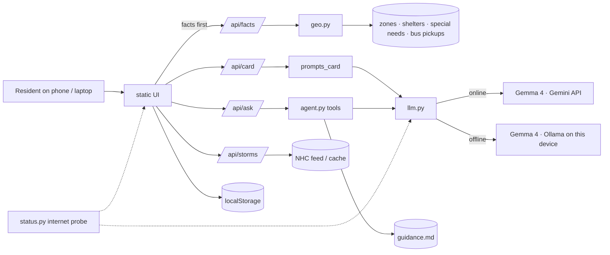

# StormCard (h4h-miami) Architecture

Long-term memory for agents and both partners; read before every task. Keep it true: update after each change per `ARCHI-rules.md`.

## 1. Overview

StormCard turns a Miami-Dade location into a one-page hurricane action card in **Kreyòl, Español or English**, then answers follow-up questions, **including with no internet**: offline, Gemma 4 runs locally on the device running StormCard.

- **Event:** Hack for Humanity: Miami, Oct 10 2026 · build ends 15:30, submit by 15:45 (target 15:00).
- **Track:** 01 Four Forces, One City (Air + Water). **Prizes stacked:** MLH Best Open-Source AI (open-weight Gemma 4 running locally) + Best Use of Gemma 4 (Gemini API).
- **Persona:** Madame Joseph (**composite**): 74, Little Haiti, Creole only, small dog, no car, using it alone on her phone.
- **Deployment model today:** one machine runs Flask + Ollama (the laptop for the demo); a phone on the same Wi-Fi opens it as a home-screen app. **Future:** Gemma 4 E2B on the phone itself; optional shared community hubs. A "hub" is not a distinct architecture: it is the same app on a volunteer's laptop.

## 2. Core Principles

1. **Facts by code, words by model.** Zone letters, shelter names, addresses, phone numbers come only from data; code fills `{{SLOT}}`s. Model text with invented places/addresses/phones/zones is replaced.
2. **Never overclaim.** Shelters are planning candidates ("call 311 to confirm open"); no category-based or "you must evacuate" claims; every card ends with the official-orders line; NHC facts only, no threat interpretation.
3. **Deterministic core first.** `/api/facts` (zone, shelters, bus pickups) works with no model; any model failure still ships the facts card.
4. **Offline is automatic.** The server probes internet reachability (`status.py`); no user switch. Online → Gemini + Google map; offline → local Gemma + SVG chart + cached data.
5. **Show the evidence.** Backend badge, "How StormCard decided" trace, data sources on screen.
6. **Keep it boring.** No database, auth, build step, framework, service worker. All runtime assets self-hosted; the only external scripts are Google Maps JS (online + key only).

## 3. Technology Stack

| Layer | Technology |
| --- | --- |
| Server | Python 3.14 + Flask (`app.py`), `requests`, `python-dotenv` |
| Frontend | `static/index.html` + vanilla JS modules, CSS tokens, Overpass ExtraBold (OFL, self-hosted), GSAP 3.13 (self-hosted, standard no-charge license) |
| Maps | Google Maps JavaScript API (online, `MAPS_API_KEY`); offline SVG tracking chart (`chart.js`) |
| Geo | Pure-Python ray-cast point-in-polygon + haversine (`geo.py`) |
| Online model | Gemma 4 `gemma-4-26b-a4b-it` via Gemini API (`google-genai`), `thinking_level="minimal"` (card 75 s → 4 s) |
| Offline model | Gemma 4 `gemma4:e2b-it-qat` via Ollama, `think: false` (8 GB laptop can't load e4b; e4b if RAM allows) |
| Persistence | Browser `localStorage` (saved card, checklists, onboarding flag) |
| Native shell | `ios/` SwiftUI WKWebView wrapper (XcodeGen); demo uses Safari Add to Home Screen instead |
| Dev | Claude Code + TRIP, Codex CLI (reviews), impeccable (design), pytest |

License MIT. Gemma: link the official Gemma terms in the README.

## 4. Project Structure

```
app.py            Flask routes (§6); Miami-Dade bounds check (422 outside)
geo.py            get_zone, find_shelters (pets: confirmed first, unknown kept), find_special_needs, find_bus_pickups
llm.py            generate(prompt, force_offline, deadline) -> (text, "gemini"|"ollama"); warm()
status.py         internet() probe (20 s cache, HUB_OFFLINE=1 rehearsal), mark_down()
agent.py          Ask agent: JSON tool loop, ≤3 steps, 60 s budget, grounding check, Kreyòl/Spanish keyword map
prompts_card.py   card prompt (model writes 2 sections), slot fill, validation, facts-only card, medical/EEAP lines
prompts_ask.py    grounded single-call Ask prompt + IDK strings (agent fallback)
storms.py         nearest Atlantic NHC system, cached to data/storms_cache.json (gitignored)
gemma.py          original Gemini prototype (superseded by llm.py)
data/             zones · shelters (FDEM) · special_needs_shelters · bus_pickups · guidance.md (cited)
static/           index.html, styles.css, card.js, ask.js, chart.js, gmap.js, storm.js, hub.js, motion.js,
                  onboard.js/.css, i18n*.js (kre/es/en), brand/, icons/ + manifest.webmanifest, fonts/, vendor/gsap.min.js
ios/              native wrapper project (project.yml, StormCard/)
evals/            per-language card eval set (36 cases) + runner
tests/, test_*.py pytest (geo, card, ask, agent, llm, storms)
docs/             ARCHI, PLAN (1-plans/), MOBILE, architecture/ (Archify diagram), TRIP folders
.impeccable/      design direction contract (surfaces/), review screenshots
```

## 5. Configuration (`.env`, gitignored; template `.env.example`)

| Variable | Default | Purpose |
| --- | --- | --- |
| `GEMINI_API_KEY` | — | Gemini API (server only) |
| `GEMMA_MODEL` | `gemma-4-26b-a4b-it` | online model |
| `GEMINI_TIMEOUT` | `30` | per-call cap (also bounded by request deadline) |
| `OLLAMA_URL` / `OLLAMA_MODEL` | `localhost:11434` / `gemma4:e2b-it-qat` | local model |
| `MAPS_API_KEY` | empty | Maps-only key sent to the browser (needs billing + Maps JS API); empty = chart only |
| `HUB_OFFLINE` | unset | `1` = behave as if the internet is down (rehearsal) |

## 6. Server API

| Route | Returns |
| --- | --- |
| `GET /` | `static/index.html` (static served at root) |
| `POST /api/facts` `{lat,lng,lang,flags}` | instant `{facts:{zone,lang,flags,shelters,home,special_needs_shelters?,bus_pickups?},sources,sample_data}` |
| `POST /api/card` (+`force_offline`) | `{zone,shelters,card_text:{what_this_means,where_to_go,what_to_bring,what_to_do_now},backend,facts,sources,sample_data,special_needs_shelters?,bus_pickups?}` |
| `POST /api/ask` `{question,lang,card,force_offline}` | `{answer,backend,trace:[{tool,args,result_summary}]}` |
| `GET /api/status` | `{internet}` (drives UI mode) |
| `GET /api/config` | `{maps_api_key (empty offline), internet}` |
| `GET /api/storms?lat&lng` | `{available,stale,fetched_at,source,storm:{name,classification,intensity_kt,pressure_mb,movement_*,watches_warnings,distance_mi,bearing_deg,last_update,advisory_url,graphics_url}|null}` |
| `GET /api/zones` | surge-zone GeoJSON for the map overlay |

Outside the Miami-Dade box → `422 outside_miami_dade`. Server logs one `[card]`/`[ask]` line per request (backend, timing, trace).

## 7. Data

| File | Source | Notes |
| --- | --- | --- |
| `zones.geojson` | Miami-Dade StormSurgePlanningZone_Multipart (property `zone` A–E) | Presets: Little Haiti 25.83,-80.189 → C · Hialeah → none · Brickell → B |
| `shelters.geojson` | FDEM General Risk Shelter Inventory, Miami-Dade, as of 2021-08-31 (40) | county live layers are empty off-season; candidates only |
| `special_needs_shelters.geojson` | FDEM Special Needs inventory (6) | shown when `medical` |
| `bus_pickups.geojson` | Miami-Dade Emergency Evacuation Bus Pick-Up sites (129) | `active` = activated now; buses run only on evacuation orders; shown when `no_car` |
| `guidance.md` | Miami-Dade EM + ready.gov, cited per section | Ask grounding; pet rules conflict noted (confirm with Animal Services) |
| `storms_cache.json` | NHC `CurrentStorms.json` | refetched ≤ every 10 min; stale when offline |

## 8. Gemma 4 Integration

- **`llm.generate`**: Gemini unless offline/forced (cap = min(timeout, deadline)); on failure marks the internet down and uses Ollama; raises only `LLMError`.
- **Card**: model writes only `what_this_means` + `what_to_do_now`, and only from Gemini; `where_to_go`/`what_to_bring` always from the code template; offline or Ollama → facts-only card. Guards: placeholder normalisation (`**ZONE**`→`{{ZONE}}`), address/phone/zone/place-word (incl. HS/MS/ES) rejection, no "evacuate" wording (Stuti's fixed LEAVE sentence instead).
- **Ask agent** (`agent.py`): tools `find_shelters`, `get_zone`, `packing_list`, `lookup_guidance`, `evacuation_help` (incl. nearest bus pickups); every answer grounded on ≥1 tool; `_grounded` rejects any unknown place/address/phone/zone → localized "I don't know. Call 311."

## 9. UI Flow (`.impeccable/surfaces/static-index-html.md` is the binding design contract)

First-run GSAP welcome (3 beats, skippable, `?welcome=1` to replay) → storm card + **Language** → **Place** (presets; GPS needs HTTPS) → **Household** toggles (pet, no car, medical, kids) → **Card**: compact storm strip, navy zone plate, backend badge, map (Google + zone overlay + home/shelters/bus markers, or SVG chart offline) with legend, shelter arrow plates (bearing, reason word, Directions link), single red 311 line, household sections (medical/EEAP checklist, pets, no-car + bus pickups, kids), card text, "How StormCard decided", **Ask** (chips, hub-status line, per-answer badge + trace). Fast GSAP motion (≤0.28 s, reduced-motion aware). Phone install via Safari Add to Home Screen (`docs/MOBILE.md`).

## 10. Data Flow



## 11. Errors, Testing, Security

- **Errors:** Gemini fail → Ollama → facts-only/IDK; card text failure keeps facts with retry; map failure/offline/no key → chart; storm fetch failure → cache or hidden.
- **Tests:** `.venv/bin/python -m pytest -q test_geo.py test_prompts_card.py tests/` (39); `node --check static/*.js`; `evals/run_evals.py` for card quality; manual: offline rehearsal with `HUB_OFFLINE=1` or Wi-Fi off.
- **Security:** keys only in `.env` (gitignored, scan before commit); Maps key is browser-exposed by design (restrict by referrer); model text rendered as text; Ask ignores instructions inside questions; agent has a hard deadline.

## 12. Team & Out of Scope

- **Ownership:** Stuti — card slice (geo, prompts_card, data, evals, mobile/iOS notes); Piyush — AI slice (llm, agent, Ask, storms, status, UI integration). Branches merge into `main`; notes in `Communication.md`.
- **Out of scope today:** on-phone model (future), shared hubs (future), live shelter capacity (no feed → 311), address geocoding, SMS/accounts, other counties, Creole TTS, NHC cone drawn on our map (link only), regular Metrobus timetables (suspended in storms).
